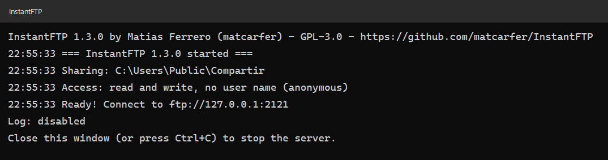

<h1 align="center">InstantFTP</h1>

<h2 align="center"><a href="https://github.com/matcarfer/InstantFTP/releases/download/v1.2.1/InstantFTP-v1.2.1.exe">⬇ Download EXE</a></h2>

  <a href="README.md">Español</a> · <b>English</b>  
Portable FTP server, super fast and lightweight (56 KB), no GUI. 
<b>Compatible with Windows 98 SE to 11.</b>

  

**How to use:** copy it into a folder and double-click it. That folder is shared until you close the window.

> By default, anyone on your network can read and write. To protect it, use `-g` or `-u`.

Options

| Option | What it does |
|---|---|
| `-g` or `-r` | Read only |
| `-u user:pass` | Ask for user and password |
| `-p port` | Port (21, or 2100 if busy) |
| `-tp p-p2` | Passive port range |
| `-ha ip` / `-b ip` | Public IP / local IP |
| `-t sec` / `-m n` | Idle timeout (300) / max clients (20) |
| `-a` · `-nolog` · `-lang en` | Hidden files · no log · language |
| `folder` | Share another folder |

If Windows or the antivirus warns you

It is not code-signed. Choose **More info → Run anyway**. Some antivirus engines flag it because it is a very small .exe: see the VirusTotal report.

  <a href="https://cafecito.app/matcarfer">☕ Cafecito</a> · <a href="https://ko-fi.com/matcarfer">☕ Ko-fi</a> · <a href="https://www.patreon.com/matcarfer">❤ Patreon</a> 
  <a href="https://github.com/matcarfer/biblioteca/blob/main/README.en.md">📚 Software library</a>

---

Free, closed source. Do not redistribute: share this link. No warranty. <a href="LICENSE.en">License</a> · <a href="https://www.virustotal.com/gui/file/a9afe37f6d6e697e303ca853901e24afc1e59bc904038e203c4d05bbabe90602">VirusTotal</a>
