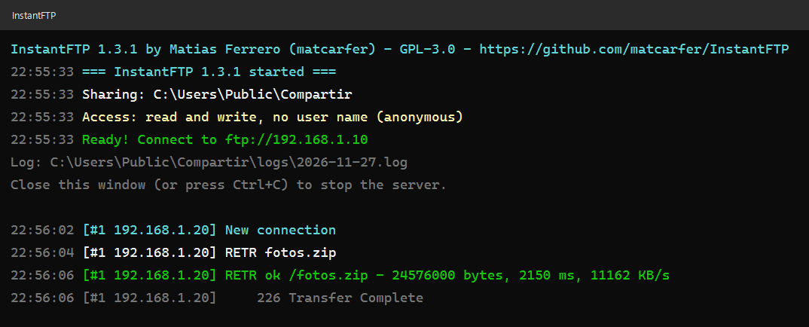

<p align="center"></p>

<h1 align="center">InstantFTP</h1>

<h2 align="center"><a href="https://github.com/matcarfer/InstantFTP/releases/download/v1.3.1/InstantFTP-v1.3.1.exe">⬇ Download EXE</a></h2>

<p align="center">
  <a href="README.md">Español</a> · <b>English</b><br><br>
  <a href="https://cafecito.app/matcarfer">☕ Cafecito</a> · <a href="https://www.matecito.co/matcarfer">🧉 Matecito</a> · <a href="https://link.mercadopago.com.ar/matcarfer">💙 Mercado Pago</a> · <a href="https://ko-fi.com/matcarfer">☕ Ko-fi</a> · <a href="https://www.patreon.com/matcarfer">❤ Patreon</a> · <a href="https://github.com/sponsors/matcarfer">💖 GitHub Sponsors</a><br><br>
Portable FTP server, super fast and lightweight (56 KB), no GUI. Open source.<br>
<b>Compatible with Windows 98 SE to 11.</b>
</p>

<p align="center">
  
</p>

**How to use:** copy it into a folder and double-click it. That folder is shared until you close the window.

> By default, anyone on your network can read and write. To protect it, use `-g` or `-u`.

<details><summary>Options</summary>

| Option | What it does |
|---|---|
| `-g` or `-r` | Read only |
| `-u user:pass` | Ask for user and password |
| `-p port` | Port (21, or 2100 if busy) |
| `-tp p-p2` | Passive port range |
| `-ha ip` / `-b ip` | Public IP / local IP |
| `-t sec` / `-m n` | Idle timeout (300) / max clients (20) |
| `-a` · `-nolog` · `-lang en` | Hidden files · no log · language |
| `folder` | Share another folder |

</details>

<details><summary>If Windows or the antivirus warns you</summary>

It is not code-signed. Choose **More info → Run anyway**. Some antivirus engines flag it because it is a very small .exe. The source code is here: you can review it and build it yourself.

</details>

<details><summary>Build from source</summary>

Rust `#![no_std]`, no dependencies, for a custom i586 target (no SSE): that is why it runs on Windows 98.

```sh
sudo apt install gcc-mingw-w64-i686   # Linux / WSL
sh build.sh                           # -> target/i586-win9x-windows-gnu/release/InstantFTP.exe
```

On Windows: MSYS2 with `mingw-w64-i686-gcc` in PATH, then `build.bat`.

Tests:

```sh
cargo test
cargo build && python3 tests/e2e.py target/debug/InstantFTP
```

How it is built: [ARCHITECTURE.md](ARCHITECTURE.md). Contributing rules (people and AI): [AGENTS.md](AGENTS.md). GitHub CI builds and tests every change, and publishes the release when the version goes up.

</details>

<p align="center">
  <a href="https://github.com/matcarfer/biblioteca/blob/main/README.en.md">📚 Software library</a>
</p>

---

<sub>By <b>Matías Ferrero</b> (<a href="https://github.com/matcarfer">matcarfer</a>). Free software: <a href="LICENSE.en">GPL-3.0-or-later</a> (<a href="LICENSE">Spanish summary</a>). Provided as is, without warranty; use at your own risk. Donations are voluntary.</sub>
