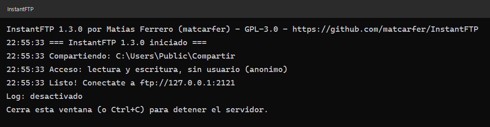

<p align="center"></p>

<h1 align="center">InstantFTP</h1>

<h2 align="center"><a href="https://github.com/matcarfer/InstantFTP/releases/download/v1.3.0/InstantFTP-v1.3.exe">⬇ Descargar EXE</a></h2>

<p align="center">
  <b>Español</b> · <a href="README.en.md">English</a><br><br>
  <a href="https://cafecito.app/matcarfer">☕ Cafecito</a> · <a href="https://www.matecito.co/matcarfer">🧉 Matecito</a> · <a href="https://link.mercadopago.com.ar/matcarfer">💙 Mercado Pago</a> · <a href="https://ko-fi.com/matcarfer">☕ Ko-fi</a> · <a href="https://www.patreon.com/matcarfer">❤ Patreon</a> · <a href="https://github.com/sponsors/matcarfer">💖 GitHub Sponsors</a><br><br>
Servidor FTP portable, súper rápido y liviano (56 KB), sin interfaz gráfica. Código abierto.<br>
<b>Compatible con Windows 98 SE a 11.</b>
</p>

<p align="center">
  
</p>

**Cómo se usa:** copialo en una carpeta y hacé doble clic. Esa carpeta queda compartida hasta que cerrás la ventana.

> Por defecto, cualquiera en tu red puede leer y escribir. Para protegerla, usá `-g` o `-u`.

<details><summary>Opciones</summary>

| Opción | Qué hace |
|---|---|
| `-g` o `-r` | Solo lectura |
| `-u usuario:clave` | Pide usuario y clave |
| `-p puerto` | Puerto (21, o 2100 si está ocupado) |
| `-tp p-p2` | Rango de puertos pasivos |
| `-ha ip` / `-b ip` | IP pública / IP local |
| `-t seg` / `-m n` | Inactividad (300) / máximo de clientes (20) |
| `-a` · `-nolog` · `-lang es` | Archivos ocultos · sin log · idioma |
| `carpeta` | Comparte otra carpeta |

</details>

<details><summary>Si Windows o el antivirus avisa</summary>

No está firmado. Elegí **Más información → Ejecutar de todas formas**. Algunos antivirus lo marcan por ser un .exe muy chico. El código está acá: podés revisarlo y compilarlo vos.

</details>

<details><summary>Compilar desde el código</summary>

Rust `#![no_std]`, sin dependencias, para un target i586 propio (sin SSE): por eso anda en Windows 98.

```sh
sudo apt install gcc-mingw-w64-i686   # Linux / WSL
sh build.sh                           # -> target/i586-win9x-windows-gnu/release/InstantFTP.exe
```

En Windows: MSYS2 con `mingw-w64-i686-gcc` en el PATH y `build.bat`.

Tests:

```sh
cargo test
cargo build && python3 tests/e2e.py target/debug/InstantFTP
```

Cómo está hecho: [ARCHITECTURE.es.md](ARCHITECTURE.es.md). Reglas para colaborar (personas e IA): [AGENTS.md](AGENTS.md). El CI de GitHub compila y prueba cada cambio, y publica la release cuando sube la versión.

</details>

<p align="center">
  <a href="https://github.com/matcarfer/biblioteca">📚 Biblioteca de software</a>
</p>

---

<sub>Por <b>Matías Ferrero</b> (<a href="https://github.com/matcarfer">matcarfer</a>). Software libre: <a href="LICENSE">GPL-3.0-or-later</a> (<a href="LICENSE.en">texto oficial</a>). Se ofrece tal cual, sin garantía; usalo bajo tu responsabilidad. Las donaciones son voluntarias.</sub>
